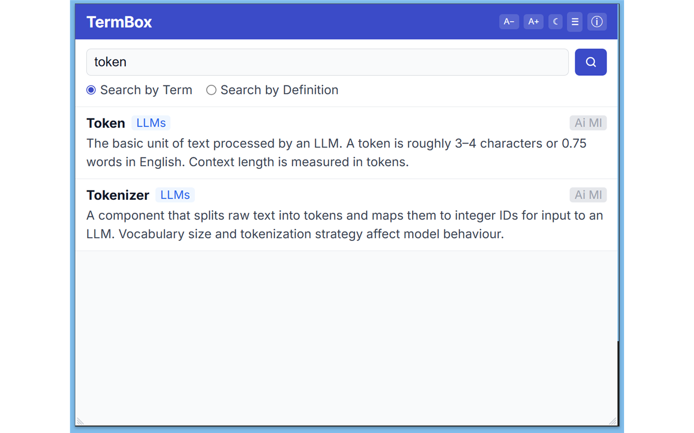
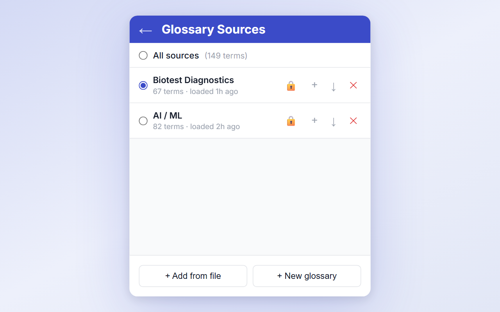
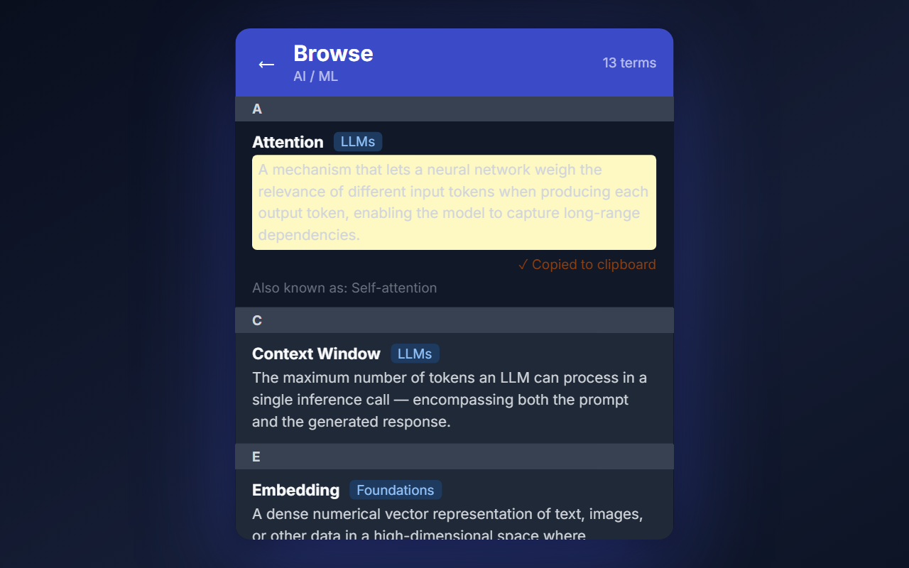

# TermBox — Glossary & Acronym Lookup

**Build your own glossary or acronym finder — from any CSV, in seconds.**

Load your terminology list once and search it instantly from the browser toolbar. TermBox is designed for anyone who works with domain-specific language: look up acronyms, expand abbreviations, browse technical terms, or reference any jargon you deal with daily.

No accounts. No backend. No subscription. Works fully offline.

> **Official source notice** — The only official, secure, and verified distribution of TermBox is the listing on the [Chrome Web Store](https://chrome.google.com/webstore). Installing this extension from any other source, store, or website is unauthorized, unverified, and entirely at your own risk.

| Search | Sources | In Chrome |
|---|---|---|
|  |  |  |

## Demo

[](https://www.youtube.com/watch?v=EF23GCdetM4)

---

## Features

- **Build your own glossary** — bring any CSV and TermBox turns it into a searchable tool
- **Create a glossary from scratch** — use the in-app editor to build a glossary without a CSV file
- **Add terms manually** — add term, full form, and definition directly from the Sources panel
- **Acronym lookup** — expand abbreviations instantly; supports `full_form` and `aliases` columns
- Load from a **local CSV file**
- **Multiple named sources** — switch between glossaries or search across all at once
- **Fully offline** after first load — instant local search, no server round-trips
- **Search by term** or **search by definition**
- Smart result ranking: exact → prefix → alias → substring
- **Export to CSV** — download any loaded glossary back to a CSV file
- Dark mode, font size controls, resizable popup
- No tracking, no external requests

## Browser support

| Browser | Status |
|---|---|
| Chrome | v1 — initial release |
| Edge | v1 — works without changes (Chromium-based) |
| Firefox | Planned |
| Safari | Planned |

---

## CSV format

```csv
term,full_form,definition,domain,source_reference,aliases
PCR,Polymerase Chain Reaction,A technique used to amplify DNA,Molecular Biology,,qPCR;rt-PCR
API,Application Programming Interface,A set of rules for software communication,Software,,
```

| Column | Required | Notes |
|---|---|---|
| `term` | Yes | The term or acronym |
| `full_form` | No | Expanded form of the term |
| `definition` | Yes | The definition |
| `domain` | No | Subject area tag |
| `source_reference` | No | Citation or reference |
| `aliases` | No | Semicolon-separated alternative names |

- Column header names are **case-insensitive** and **order-independent**
- Quoted fields with commas inside are supported (RFC 4180)
- Encoding: UTF-8

---

## Sample glossaries

The `samples/` folder contains ready-to-use CSV files you can load straight into TermBox.


| File | Description | Download |
|---|---|---|
| `biotest-diagnostics.csv` | 67-term IVD / medical device glossary | [Download](https://github.com/fuvito/termbox/blob/main/samples/biotest-diagnostics.csv) |
| `biotest-diagnostics-expanded.csv` | Expanded IVD / medical device glossary with richer definitions | [Download](https://github.com/fuvito/termbox/blob/main/samples/biotest-diagnostics-expanded.csv) |
| `biotest-diagnostics-acronyms-expanded.csv` | IVD / medical device acronyms with fully expanded forms | [Download](https://github.com/fuvito/termbox/blob/main/samples/biotest-diagnostics-acronyms-expanded.csv) |
| `ai-ml.csv` | 82-term AI and machine learning glossary | [Download](https://github.com/fuvito/termbox/blob/main/samples/ai-ml.csv) |
| `ai-ml-expanded.csv` | Expanded AI / ML glossary with richer definitions | [Download](https://github.com/fuvito/termbox/blob/main/samples/ai-ml-expanded.csv) |

### [`biotest-diagnostics.csv`](https://github.com/fuvito/termbox/blob/main/samples/biotest-diagnostics.csv)

A 67-term glossary for the in vitro diagnostics (IVD) and medical device industry, covering:

| Domain | Example terms |
|---|---|
| Molecular Biology | PCR, qPCR, ddPCR, DNA, RNA |
| Genomics | NGS, WGS, SNP |
| Immunology | ELISA, CLIA, LFA, IgG, IgM |
| Clinical Chemistry | CRP, HbA1c, troponin, LDL |
| Oncology | ctDNA, TMB, PD-L1, PSA |
| Neurology | MS, Amyloid Beta, Tau, APOE |
| Medical Imaging | MRI, CT, PET |
| Analytical / Statistics | LOD, LOQ, CV, Sensitivity, Specificity, PPV, NPV, ROC, AUC |
| Regulatory | IVD, IVDR, MDR, CE, FDA, EMA, IFU, UDI, GLP, ICH |
| Quality | SOP, CAPA, GMP, QMS, DHF, NCR, OOS |

### [`ai-ml.csv`](https://github.com/fuvito/termbox/blob/main/samples/ai-ml.csv)

An 82-term glossary covering the AI and machine learning landscape:

| Domain | Example terms |
|---|---|
| Foundations | AI, ML, Deep Learning, Neural Network, Transfer Learning |
| LLMs | LLM, GPT, Transformer, Attention, Context Window, Token, Hallucination |
| Prompting | Prompt Engineering, Few-Shot, Zero-Shot, Chain-of-Thought, System Prompt |
| Training & Alignment | RLHF, SFT, DPO, Fine-Tuning, LoRA, QLoRA, PEFT |
| Generative AI | GAN, VAE, Diffusion Model, RAG, Multimodal |
| Evaluation | Perplexity, BLEU, ROUGE, MMLU, HumanEval, Benchmark |
| Core ML concepts | Overfitting, Dropout, Batch Norm, Loss Function, Gradient Descent, Adam |
| Deployment | Inference, Quantisation, Pruning, Distillation, ONNX, GPU, TPU |
| AI Agents | Agent, Tool Use, MCP, Agentic Loop, Semantic Search, Vector Database |
| AI Safety | Alignment, Guardrails, Prompt Injection, Jailbreak |

To use any sample, open TermBox → **≡** → **Add from file** → select the downloaded CSV.

---

## Chrome Web Store listing

When submitting to the Chrome Web Store, use the following copy. Keywords are woven into the description naturally — the Store's search indexes the description text, so there's no separate keyword field.

### Single purpose statement
```
TermBox lets users load CSV files as searchable glossaries and look up terms, acronyms, and definitions from the browser toolbar.
```
This is what you paste into the **"Single purpose"** field during submission. It must describe one narrow action — loading and searching a glossary. Do not mention features like dark mode or resizing here; those are incidental to the core purpose.

### Permission justification

Paste each entry below into the corresponding permission row in the CWS dashboard.

| Permission | Justification |
|---|---|
| `storage` | Persists glossary sources, term data, and user preferences (dark mode, font size, popup size) locally on the user's device via `chrome.storage.local`. No data ever leaves the device. |
| `optional_host_permissions: <all_urls>` | Reserved for a future URL-loading feature. Not used at runtime in the current version — no permission is ever requested or granted. Declared so the capability can be enabled in a future update without a manifest change. |

The manifest declares no other permissions (`activeTab`, `tabs`, `scripting`, `cookies`, `history`, etc. are all absent — they are not needed).

### Remote code

**Answer: No.**

All JavaScript is bundled into the extension package at build time by Vite. Nothing is fetched and executed at runtime. CSV content loaded from user-supplied URLs is treated as plain text data — it is parsed locally and never evaluated as code. The extension contains no `eval()`, `new Function()`, or dynamically injected `<script>` tags.

### Privacy policy URL

```
https://github.com/fuvito/termbox/blob/main/PRIVACY.md
```

Paste this into the **"Privacy policy"** field in the CWS dashboard. The page is publicly accessible without login and renders as readable HTML. The policy covers: local-only storage, no analytics, no tracking, and when/why network requests are made.

### Name (45 chars max)
```
TermBox — Glossary & Acronym Lookup
```

### Short description (132 chars max)
```
Build your own glossary or acronym finder from any CSV. Instant offline lookup from the toolbar. No account needed.
```

### Detailed description
```
TermBox turns any CSV file into a fast, searchable glossary — available instantly from your browser toolbar.

Perfect for:
• Acronym lookup and abbreviation expansion
• Technical glossaries (medical, legal, engineering, AI/ML, finance)
• Team or company-specific terminology
• Any domain jargon you need close at hand

HOW IT WORKS
1. Prepare a CSV with a "term" and "definition" column (plus optional full_form, aliases, domain)
2. Load it into TermBox from a local file
3. Search instantly — no internet connection needed

KEY FEATURES
✓ Build your own custom glossary — bring any CSV
✓ Create a glossary from scratch — no CSV needed, add terms directly in the app
✓ Acronym expander — add a full_form column to expand abbreviations
✓ Aliases — one entry can match multiple names (e.g. "PCR", "qPCR", "rt-PCR")
✓ Multiple glossaries — load several sources and search across all of them
✓ Search by term name or search inside definitions
✓ Smart ranking: exact match → prefix → alias → substring
✓ Export any glossary back to CSV — your data is always yours
✓ Fully offline after first load — no server, no account, no subscription
✓ Dark mode, adjustable font size, resizable popup

✓ Open source — MIT licence, code on GitHub

SAMPLE FILES INCLUDED
The GitHub repo ships with five ready-to-use glossaries:
• biotest-diagnostics.csv — 67 IVD/medical device terms
  https://github.com/fuvito/termbox/blob/main/samples/biotest-diagnostics.csv
• biotest-diagnostics-expanded.csv — expanded IVD/medical device glossary
  https://github.com/fuvito/termbox/blob/main/samples/biotest-diagnostics-expanded.csv
• biotest-diagnostics-acronyms-expanded.csv — IVD acronyms with expanded forms
  https://github.com/fuvito/termbox/blob/main/samples/biotest-diagnostics-acronyms-expanded.csv
• ai-ml.csv — 82 AI and machine learning terms
  https://github.com/fuvito/termbox/blob/main/samples/ai-ml.csv
• ai-ml-expanded.csv — expanded AI/ML glossary with richer definitions
  https://github.com/fuvito/termbox/blob/main/samples/ai-ml-expanded.csv

PRIVACY
Stores data only on your device using Chrome's local storage.
No analytics, no tracking, no external connections.
```

### Category
`Productivity`

### Keywords to emphasise in screenshots / promo tile
glossary, acronym finder, acronym lookup, abbreviation expander, CSV glossary, terminology, term lookup, offline dictionary, custom dictionary

---

## Installation (Chrome)

### From the Chrome Web Store _(coming soon)_

Search for **TermBox** in the [Chrome Web Store](https://chrome.google.com/webstore) and click **Add to Chrome**.

### From source (manual)

1. Clone the repo and build:
   ```bash
   git clone https://github.com/fuvito/termbox.git
   cd termbox
   npm install
   npm run build
   ```
2. Open Chrome and go to `chrome://extensions`
3. Enable **Developer mode** (top-right toggle)
4. Click **Load unpacked** and select the `dist/` folder
5. The TermBox icon appears in your toolbar — click it to open

To update after a `git pull`, run `npm run build` again and click the refresh icon on the extension card in `chrome://extensions`.

---

## Running locally (browser dev server)

You can develop and test the popup in a regular browser tab — no extension install needed.

```bash
npm install
npm run serve
```

Then open [http://localhost:5173/popup.html](http://localhost:5173/popup.html).

> The dev server auto-opens this URL in your default browser when started.

`chrome.storage.local` is automatically replaced with a `localStorage`-backed mock, so adding sources and searching works exactly as it would in the real extension.

---

## Scripts

| Command | Description |
|---|---|
| `npm run serve` | Start Vite dev server — test in browser without installing as extension |
| `npm run dev` | Watch-build to `dist/` — reload unpacked extension in Chrome as you edit |
| `npm run build` | Production build to `dist/` |
| `npm run typecheck` | TypeScript type check (no emit) |
| `npm run icons` | Regenerate `public/icon16/48/128.png` from the Node.js generator script |

### Packaging for the Chrome Web Store

After `npm run build`, zip the contents of the `dist/` folder (not the folder itself):

```bash
# macOS / Linux
cd dist && zip -r ../termbox.zip . && cd ..

# Windows (PowerShell)
Compress-Archive -Path dist\* -DestinationPath termbox.zip -Force
```

Upload `termbox.zip` at the [Chrome Web Store Developer Dashboard](https://chrome.google.com/webstore/devconsole).

---

## Project structure

```
termbox/
  public/
    manifest.json       Chrome MV3 manifest
  src/
    popup.tsx           React UI — SearchView, SourcesView, App
    background.ts       Minimal MV3 service worker
    types.ts            TermEntry, GlossarySource interfaces
    search.ts           rankTerms() search algorithm
    csv.ts              RFC 4180 CSV parser
    storage.ts          chrome.storage.local helpers
    chrome-mock.ts      localStorage mock for dev server
  popup.html            Extension popup shell
  vite.config.ts        Dual entry (popup + background)
  tsconfig.json
  package.json
```

---

## Tech stack

- **React 19** — UI
- **TypeScript 7** — language
- **Vite 8** — bundler
- **chrome.storage.local** — persistence
- **Inline styles** — no CSS framework
- **No external runtime dependencies** beyond React

---

## Disclaimer

TermBox is designed for glossaries, acronym lists, and terminology only. It is **not** a secure storage solution. Do not use it to store passwords, credentials, API keys, or any sensitive or confidential information. All data is stored in plain text via Chrome's local storage. The user assumes full responsibility for the content they load into the extension.

---

## Privacy

TermBox stores data only on your device. No analytics, no tracking, no external servers.
See [PRIVACY.md](PRIVACY.md) for the full policy.

---

## License

The source code is released under the **MIT License** — see [LICENSE](LICENSE) for the full text including the "as is" and limitation-of-liability clauses.

**Trademark notice** — The name **TermBox**, the extension icon, and all associated branding are reserved and are **not** covered by the MIT License. While you may use, modify, and redistribute the source code freely under MIT terms, you may not use the TermBox name, logo, or branding in derivative works or redistributions without explicit written permission from the author. This is to ensure users can always identify the authentic, maintained version of this extension.

© [Fuat Yazar](https://github.com/fuvito)
